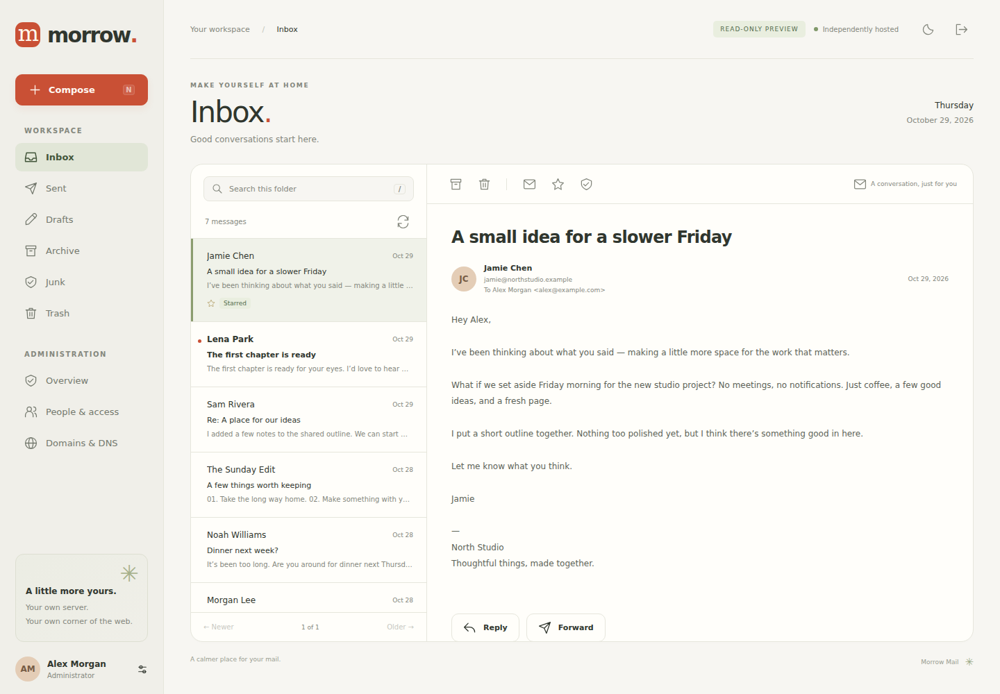
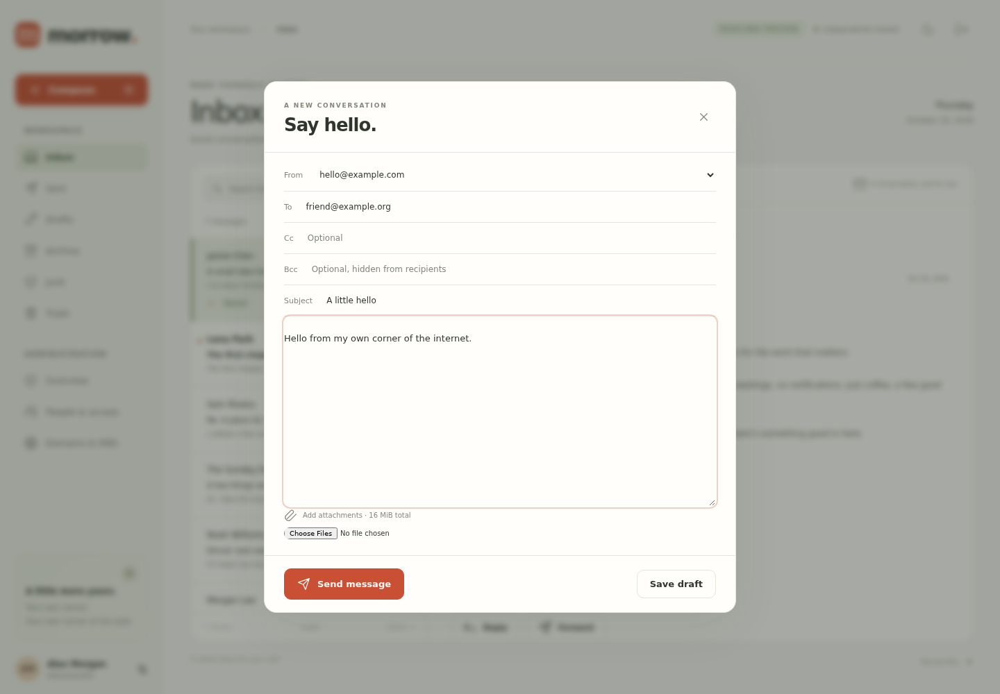
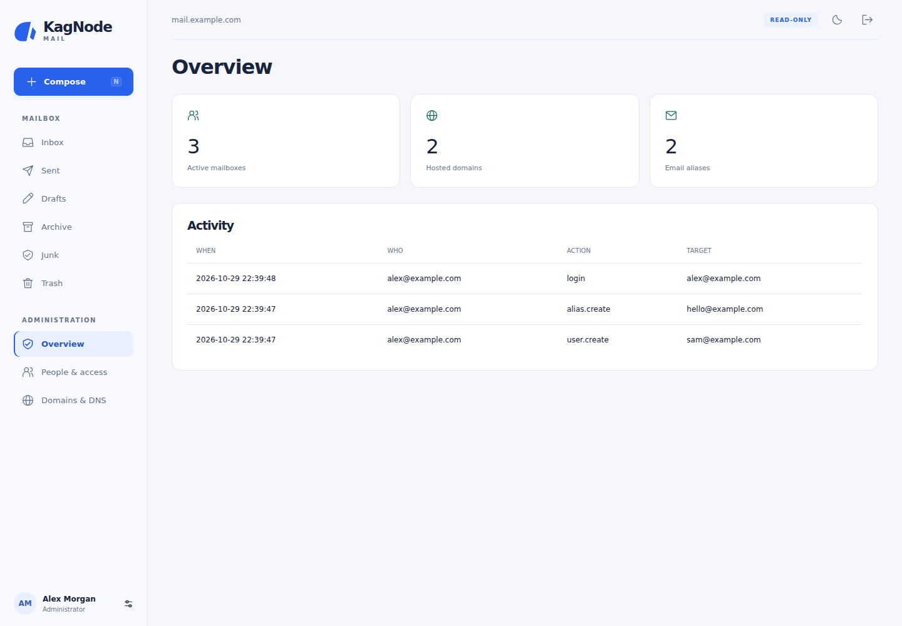
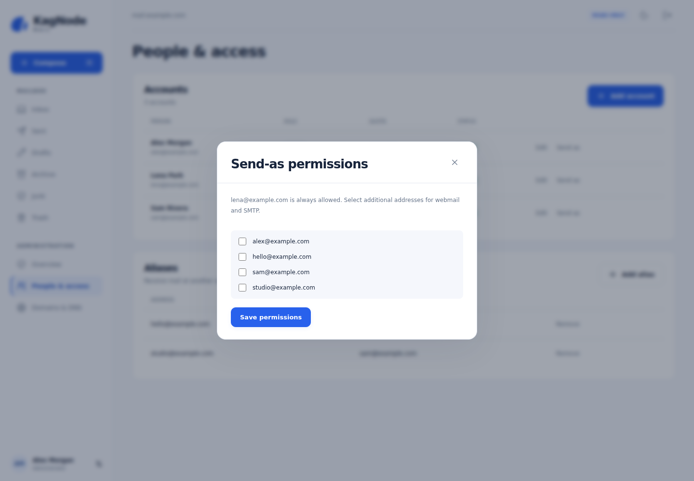
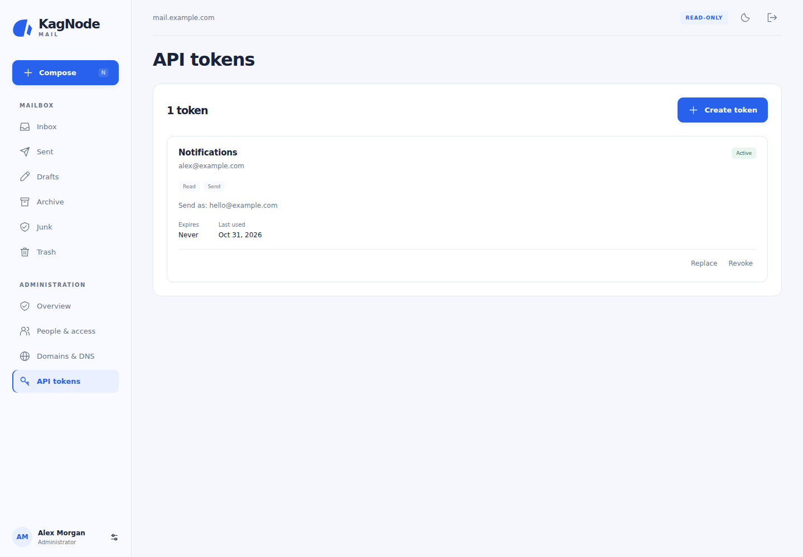
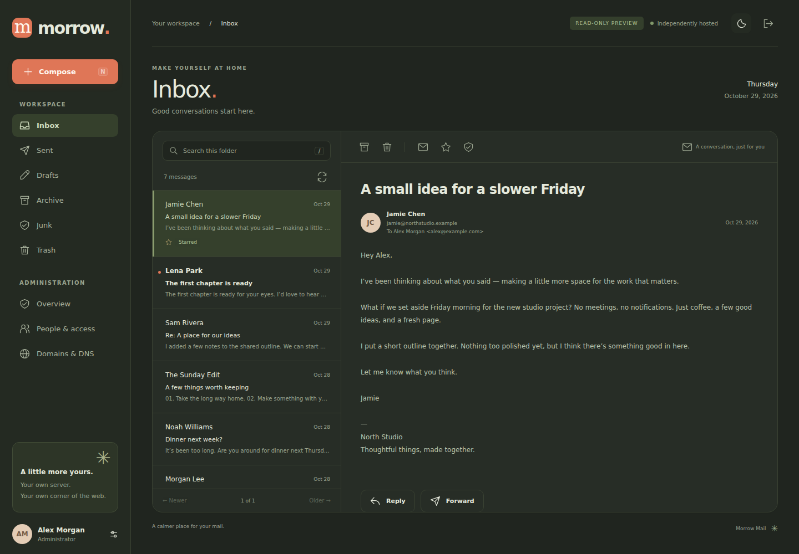
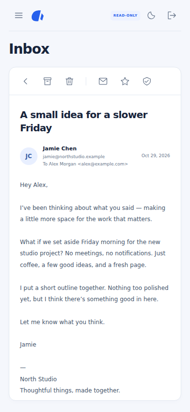

<p align="center"></p>

# KagNode Mail

Self-hosted mail, webmail and a server-only application mail API.

## Overview

Screenshots come from the read-only preview with fictional people and messages.

| Inbox and reader                                                                               | Compose                                                                        |
| ---------------------------------------------------------------------------------------------- | ------------------------------------------------------------------------------ |
|  |                          |
|                                   |  |
|                              |                            |



| Step                                   | Detail                                                                                                                      |
| -------------------------------------- | --------------------------------------------------------------------------------------------------------------------------- |
| People use the web interface           | Mailboxes, folders, search, attachments and drafts work like ordinary webmail.                                              |
| Your server delivers the mail          | KagNode Mail integrates with Postfix, Dovecot and OpenDKIM, but only after an administrator sets them up explicitly.        |
| Administrators manage the rest         | People and access, domains and DNS, sender permissions, quotas, audit records and backups live in the administration pages. |
| Applications send mail through the API | A server-only API accepts scoped, revocable tokens, so an application can send without a person's password.                 |
| Sign-in stays yours                    | Local sign-in always works.                                                                                                 |

## Release status

Product source: **5.0.3**. Stable source/data release: **5.0.3**.

KagNode 5 uses the same locally served Core login frame and action icons across applications.

## Features

- Mailboxes, folders, search, attachments, drafts and sender permissions.
- Postfix, Dovecot and OpenDKIM integration with explicit administrator setup.
- Scoped API tokens, quotas, audit records and backup tools.

## Requirements

Ubuntu Server 24.04, Python 3.12 and a dedicated mail host. Internet delivery additionally requires working DNS, TLS and reachable SMTP ports.

## Installation and downloads

Take releases only from [GitHub Releases](https://github.com/every-lemon/kagnode-mail/releases) and verify `SHA256SUMS`.

| Payload                   | Formats                      | Support                                                        |
| ------------------------- | ---------------------------- | -------------------------------------------------------------- |
| Complete source / artwork | `.tar.xz`, `.tar.gz`, `.zip` | Named top-level directory; manual setup                        |
| Source/data               | `.deb`                       | Source only; does not provision a service                      |
| Source/data               | `.rpm`                       | Rocky Linux 10 source package; no native service qualification |

## Usage

```sh
python3 -m venv .venv
.venv/bin/pip install -e ".[test]"
.venv/bin/python scripts/demo.py
```

See [operations and existing setup instructions](docs/OPERATIONS.md) for the full workflow and its prerequisites.

## Configuration and storage

Shared presentation uses [KagNode Core](docs/CORE.md), with a pinned local fallback and reviewed server adapters. Compatible stable UI patches have a separate local-administrator policy.

## Security

Use HTTPS and least-privilege accounts for hosted services. Keep secrets and user data out of Git.

## Development and testing

```sh
python -m pytest -q
python3 scripts/repository_check.py
python3 scripts/format_source.py --check
python3 scripts/release.py --output dist/packages
```

## Documentation

|                                    |                                              |
| ---------------------------------- | -------------------------------------------- |
| Reviewed local setup               | [docs/INSTALLER.md](docs/INSTALLER.md)       |
| Ecosystem installation and updates | [docs/ECOSYSTEM.md](docs/ECOSYSTEM.md)       |
| Repository structure               | [docs/STRUCTURE.md](docs/STRUCTURE.md)       |
| Operations                         | [docs/OPERATIONS.md](docs/OPERATIONS.md)     |
| Packages and release process       | [docs/PACKAGING.md](docs/PACKAGING.md)       |
| Verification and limits            | [docs/VERIFICATION.md](docs/VERIFICATION.md) |
| KagNode Account linking            | [docs/ACCOUNT-SYNC.md](docs/ACCOUNT-SYNC.md) |
| Changelog                          | [CHANGELOG.md](CHANGELOG.md)                 |

## Licensing

See [LICENSE](LICENSE) and retained third-party notices. KagNode artwork retains its separate permission and brand policy; the application uses AGPL-3.0-only.
