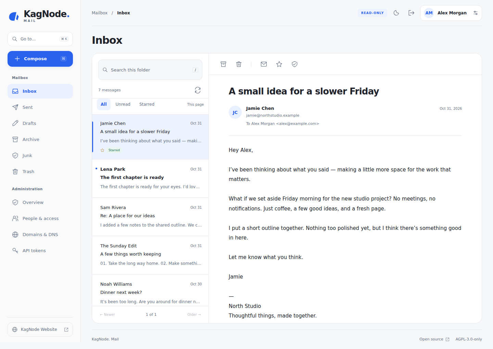

<p align="center"></p>

# KagNode Mail


Open source mail server for Ubuntu Server 24.04, with webmail and administration.



KagNode Mail installs Postfix, Dovecot, OpenDKIM, nginx, and a small Python application. SQLite keeps accounts and permissions; Maildir stores messages. No Docker, Node.js runtime, Redis, external fonts, analytics, or database server is required on your mail host.

This is the **0.5.0 release**. This release uses project-scoped paths; existing installations require the separately reviewed migration in [PATHS.md](PATHS.md). Review [validation and limitations](docs/validation.md) before putting it on the public internet. Public mail delivery also depends on your IP reputation, provider rules, DNS, and open port 25.

## What works

- KagNode blue branding with the supplied logo recreated as a small SVG, responsive webmail, system-synced light/dark themes with unchanged KagNode blue, search, pagination, reading, reply, forwarding, attachments, drafts, stars, archive, junk, and trash.
- Safe message rendering: plain text, with readable text extracted from HTML-only mail. No remote tracking images, scripts, or HTML execution.
- Admin-issued API tokens for mailbox reading, sending, drafts, and message management. Separate permissions, restricted senders, expiry, and immediate revocation. See the [API guide](docs/api.md).
- Regular members and administrators. Administrators have a normal mailbox too.
- Account creation, disabling, password reset/change, mailbox quotas, and multiple domains.
- Receiving aliases and explicit **send-as grants**, managed separately. Every member can send as their own address; extra identities require an administrator's grant.
- Sender authorization enforced by Postfix and a fail-closed submission milter, including the visible `From` header, for webmail **and native mail clients**.
- DNS records generated for each domain: A, optional AAAA, MX, SPF, DKIM, DMARC, and provider-managed PTR. Copy records, check published DNS, and update the public IPv4 used in the instructions.
- Let's Encrypt TLS, automatic certificate renewal, fail2ban, rate limits, host-scoped secure cookies, CSRF/origin checks, recent-password confirmation for admin changes, encrypted server-side credentials, an audit trail, and backup/recovery tools.

## Preview locally

Python **3.12** is required; this release targets Ubuntu 24.04 and its Python/Dovecot versions.

```bash
python3 -m venv .venv
.venv/bin/pip install -e '.[test]'
.venv/bin/python scripts/demo.py
```

Open **http://127.0.0.1:8025**. Sign in with `alex@example.com` / `KagNodePreview2026!`.

The preview uses disposable fictional data and cannot send messages or change accounts. It binds only to loopback. The preview password is never provisioned on a real installation. For a remote development host, use `ssh -L 8025:127.0.0.1:8025 your-host` and open the same URL on your computer.

## Install on Ubuntu Server 24.04

Use a **fresh, dedicated server** with a static public IPv4 address. A 1 GiB VPS is the recommended starting point; leave at least 2 GiB free for installation, plus your mailbox and backup space. Read [the DNS guide](docs/dns.md) and check that your provider allows inbound and outbound TCP **25** before buying or provisioning a host.

1. Point `mail.example.com` to your real public IP using an A record, with any HTTP proxy disabled.
2. Allow inbound TCP **25, 80, 443, 587, 993** in your provider/network firewall. Leave SSH accessible. KagNode Mail does not change or enable your firewall.
3. Download the source and review the configuration:

   ```bash
   git clone https://github.com/every-lemon/kagnode-mail.git
   cd mail
   ./install.sh --dry-run --domain example.com --hostname mail.example.com \
     --ipv4 203.0.113.10 --admin admin@example.com --output ./review
   ```

4. Replace the example names and documentation IP with your values, then run:

   ```bash
   sudo ./install.sh --domain example.com --hostname mail.example.com \
     --ipv4 203.0.113.10 --admin admin@example.com
   ```

   The installer prompts twice for a password without echoing it. For unattended setup, supply `--password-file /root/kagnode-admin-password`: a root-owned `0600` or `0400` regular file containing a 12–256 character password. Passwords are never command-line arguments. Remove that file after successful setup.

5. Sign in at `https://mail.example.com`. Open **Domains & DNS**, publish its records, and configure PTR with your IP provider. Create members and aliases under **People & access**. Use **Send as** to assign extra identities.

The installer obtains a real certificate before starting the configured mail stack. It refuses existing mail configuration/data and occupied service ports. If an owned installation stops partway through, fix the reported error and rerun the **same options with `--resume`**. Account data, DKIM keys, and application secrets are retained; managed service configuration is regenerated with backups. Do not use `--resume` as a migration tool.

`--test-certificate` creates an untrusted seven-day certificate for isolated lab testing only. Do not use this option on a public deployment.

This release uses the `kagnode` package, service account, systemd units, and `/etc/kagnode/mail`, `/opt/kagnode/mail`, `/var/lib/kagnode/mail` paths. It does **not** migrate the earlier Morrow prototype in place. Existing installations must be preserved and migrated deliberately; the installer refuses them. See [operations](docs/operations.md).

## Mail clients

| Setting | Value |
| --- | --- |
| Username | Full email address |
| IMAP | Your mail hostname, port **993**, SSL/TLS |
| SMTP | Your mail hostname, port **587**, STARTTLS, authentication required |
| Password | The same password used for webmail |
| Extra sender address | Must be an explicitly granted mailbox or alias |

POP3 and port 465 are intentionally not enabled. This release accepts ASCII domains with alphabetic top-level domains and ASCII mailbox addresses; SMTPUTF8 is not supported. Hosted mailbox names are normalized to lowercase; external recipient local parts retain their spelling. Separate Compose recipients with commas; display names and a trailing comma are supported.

## Resource use

There is one Gunicorn worker with two threads, demand-started Dovecot processes, bounded Postfix concurrency, and no persistent web polling or mail indexing daemon. Package installation uses `--no-install-recommends` and Ubuntu's maintained Python packages rather than a second production virtual environment.

**Measured core idle footprint: 82.2 MiB PSS** after two minutes idle in the Ubuntu 24.04 lab, excluding the OS, filesystem cache, and fail2ban. The following 30-second sample measured 0.033% of one CPU core. A universal RAM/idle/disk claim would be misleading. Use `sudo python3 scripts/resources.py` to measure proportional resident memory on your server, `systemd-cgtop` for CPU, and `du -sh /opt/kagnode/mail /var/lib/kagnode/mail /var/vmail` for application/data size. See [validation](docs/validation.md) for measured results and their scope. The web service has a 384 MiB hard memory cap; the sender guard has 128 MiB. These caps are ceilings, not idle estimates.

The small default stack **does not include a content spam filter or antivirus engine**. Junk is a manual folder. OpenDKIM signs outgoing mail; it is not an inbound spam/DMARC enforcement system. Read [security](SECURITY.md) before deciding whether to add filtering or move beyond a small trusted team.

## Source and downloads

[Repository](https://github.com/every-lemon/kagnode-mail) · [Releases](https://github.com/every-lemon/kagnode-mail/releases) · [Report a vulnerability privately](https://github.com/every-lemon/kagnode-mail/security/advisories/new)

## Development and checks

```bash
.venv/bin/python -m pytest -q
shellcheck install.sh scripts/*.sh tests/*.sh
# With the preview running in a separate terminal:
.venv/bin/playwright install chromium
.venv/bin/python tests/browser_check.py
```

The [GitHub Actions workflow](.github/workflows/test.yml) includes Python/shell tests and a disposable Ubuntu 24.04 mail integration test. Test containers are a development tool; production is native systemd.

- [Token API and examples](docs/api.md) · [OpenAPI specification](docs/openapi.json)
- [DNS and deliverability](docs/dns.md)
- [Architecture and permission model](docs/architecture.md)
- [Operations, backups, upgrades, and recovery](docs/operations.md)
- [Validation results and known limitations](docs/validation.md)
- [Security policy](SECURITY.md)
- [Security review and hardening details](docs/security-review.md)
- [Contributing](CONTRIBUTING.md)

AGPL-3.0-only licensed.

## KagNode 0.4 release

The Mail server is an independent, self-hosted open-source project. Its webmail remains available to mailbox users. KagNode's main and Developer websites use only the server-side send API for account and workflow emails; they do not expose a mailbox. The hosted KagNode cloud products remain planned.

New installations use `/opt/kagnode/mail`, `/etc/kagnode/mail` and `/var/lib/kagnode/mail`. Existing installations require the explicit, verified migration in [PATHS.md](PATHS.md); this release does not migrate a running server. Keep upstream Postfix, Dovecot, OpenDKIM and Maildir paths and their permissions. The existing 0.2-to-0.3 database/mail-configuration migration requirement still applies.

Current combined releases and new original work: **AGPL-3.0-only**, with retained MIT legacy and third-party notices in `LICENSES/` and `THIRD_PARTY_NOTICES.md`. Prior MIT grants remain valid. [Brand policy](BRAND-POLICY.md) is separate from software rights.

[KagNode](https://nebulacoder.com) · [Developer](https://developer.nebulacoder.com) · [Logo assets](https://github.com/every-lemon/kagnode-logos)

## KagNode 0.4.1

The configuration renderer supports a separate Mail service identity, read group, certificate directory, and one explicitly trusted reverse proxy. These options support reviewed installations alongside existing KagNode websites; the standard installer continues to require a fresh, dedicated host. See [cohosted configuration](docs/operations.md#reviewed-cohosted-configuration).

## KagNode 0.4.2

Navigation keeps mailbox and administration destinations in their own scroll area, with account controls and one KagNode Website link anchored below. Current destinations remain visible in the sidebar and quick navigation. The compact footer keeps source and license links beside the content; tablet and phone layouts use a navigation drawer. Mail protocols, API permissions and delivery behavior are unchanged. Explicit `TRUSTED_PROXIES` validation protects client addresses and HTTPS checks when an installation deliberately exposes its web listener to a LAN reverse proxy; see [operations](docs/operations.md).

## KagNode 0.4.3

Opening Mail through a direct HTTP/IP address now explains how to reach secure sign-in before asking for a password. Only the configured HTTPS Mail origin offers the production sign-in form. An incorrect proxy scheme gets a specific configuration message. Origin checks, CSRF, and secure session cookies remain enforced.

## KagNode 0.4.4

Compose validates external recipients separately from hosted mailbox names, accepting valid punctuation, quoted addresses, display names, and trailing commas. Invalid recipients identify the To, Cc, or Bcc field and prevent submission of the entire list. Mailbox connection failures show a direct explanation and a Try again button; send failures retain the warning to check delivery before retrying.

## KagNode 0.4.5

Phone and tablet inboxes have a Compose button beside Refresh. Opening the composer closes the navigation drawer so returning to mail leaves the inbox visible. Existing sidebar and keyboard shortcuts use the same composer.

## KagNode 0.5.0

- A clearer reading workspace, top-right account settings, responsive composer and message skeletons. Unread and starred filters apply to the current page and retain folder search.
- The server Token API accepts optional HTML with a required plain-text alternative. Existing sender permissions, per-recipient results and uncertain-send handling remain unchanged. Webmail continues to display safe text and block remote content from received messages.
- Updating an existing 0.4.5 installation needs matching application files and a web-service restart; this release adds no database or native mail configuration migration. Retain the existing environment, API tokens, mailboxes and TLS certificate synchronization.
