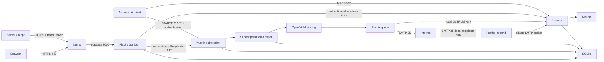

# Architecture

## Permission model

Mailboxes are virtual accounts, not Linux login users. The `vmail` system user owns message files. `kagnode` runs the web application and submission guard without sudo, shell access, or access to `/var/vmail`. It talks to Dovecot as the logged-in mailbox account.

An administrator can create/disable accounts, change quotas and passwords, add domains and receiving aliases, and grant sending identities. Administrators can issue scoped API tokens for a selected mailbox without knowing its password, and can reset passwords. The server's root administrator can read on-disk mail. This is server-hosted email, not end-to-end encrypted mail.

An account always owns its primary email address. Extra identities must name an existing local mailbox or alias. Receiving an alias does **not** automatically grant permission to send from it. A grant does **not** grant access to the destination mailbox. An administrator can send their own mail and must also hold grants to send as other identities.

Postfix's `smtpd_sender_login_maps` verifies ownership of the SMTP envelope sender. The guard additionally requires one syntactically valid visible `From` mailbox matching that envelope, rejects `Sender` and `Resent-*` identity headers, and consults the same active-user grants. Both submission listeners require authentication and run the guard before OpenDKIM. A down/unreadable guard fails closed. Incoming port 25 does not authenticate or sign messages and cannot relay to arbitrary domains, even from localhost.

The guard enforces 60 submitted messages per account per rolling window of one hour (a fixed window starting with the first accepted attempt). The web application has an additional 60-attempt per-hour limit. Postfix applies per-client connection/message controls. Submission is intended for small trusted teams, not bulk campaigns.

## Data and sessions

`/var/lib/kagnode/directory.sqlite3` holds domain names, account password hashes, roles, quotas, aliases, grants, sessions, API token metadata and encrypted internal credentials, counters, and the bounded audit log. The database uses rollback journals and a ten-second busy timeout; read access is shared only with required service accounts. The `sender_owners` SQL view keeps backend and web permissions aligned.

Passwords use Dovecot-compatible SHA512-CRYPT with 100,000 rounds. Python 3.12's `crypt` is used deliberately for compatibility with Ubuntu 24.04. **Python 3.13+ and Dovecot 2.4 are not supported** by this configuration or release.

The session cookie contains only a random token. Its SHA-256 digest is stored in SQLite. The mail password is retained **encrypted server-side** with Fernet for authenticated IMAP/SMTP operations, never put in browser storage or cookies. The encryption key and Flask signing key are generated per installation in root-owned `/etc/kagnode/config.json`. Active credentials expire after eight hours. Logout removes the server session; password changes and admin account edits revoke web sessions. Production cookies use the `__Host-` prefix, Secure, HttpOnly, SameSite=Strict, and Path=/ with no Domain attribute. At most five active sessions are retained per account. Every state-changing browser-session request, including login, requires a CSRF token; supplied Origin and Fetch Metadata headers must also describe a same-origin request. nginx enforces the configured hostname and overwrites forwarded headers before proxying.

Administrative mutations require password confirmation within 15 minutes. Reauthentication rotates the bearer token and refreshes the encrypted credential timestamp but preserves the absolute eight-hour session expiry and the existing random CSRF synchronizer token. The browser retries the blocked operation only after successful confirmation; cancel or a wrong password never executes it. No additional daemon is required.

A daily timer deletes expired sessions and rate counters, clears expired/revoked API credentials, and removes token history older than 90 days. Audit retention is capped at approximately 10,000 events. It records login, sender address on send, and account/permission changes, not message bodies, passwords, or full recipient lists.

## Integration tokens

The versioned `/api/v1` interface authenticates an Authorization bearer header independently of browser cookies. It rejects browser-origin requests; browser/admin routes never accept API tokens. Token administration uses the existing session, CSRF, and recent-password checks. Tokens are random 256-bit secrets stored only as SHA-256 hashes, bound to one account, with explicit read/send/write/delete permissions and an allowed sender subset.

A separate random internal password is generated per token, stored as a Dovecot-compatible hash and encrypted with the application key. Its login is `api-TOKEN_ID@api.invalid`; this domain is reserved. Dovecot maps that login to the owner's Maildir while preserving the token identity for SMTP authorization. IMAP accepts it only on loopback port 1143. Postfix's loopback 1587 listener alone uses `smtpd_sasl_service=kagnode-private`; public 587 retains `smtp`. The SQL query requires the private service and both loopback addresses. Public 993/587 reject internal credentials even when connecting from localhost. Dovecot authentication caching is disabled.

Postfix sender maps and the guard require the token's send scope, live account, unexpired/unrevoked token, selected sender, and current account grant. The guard checks again at end of DATA and charges the real mailbox's sending quota. Password changes/resets and account disablement revoke token records through a database trigger. Existing operations may finish, and accepted mail cannot be recalled. Tokens and sessions are excluded from backups so restoration cannot revive a revoked credential.

See the [API guide](api.md) for request schemas, permission boundaries, retry behavior, and examples. No mail password is required when an administrator issues a token.

## Message storage and rendering

Dovecot stores Maildir messages at `/var/vmail/DOMAIN/LOCALPART/Maildir`, with a default 1 GiB quota per account. Mailbox queries use IMAP UIDs; API message references also require the folder and UIDVALIDITY, checked on the same connection before the message operation. Page lists fetch headers in batches of 30. Moving mail uses IMAP MOVE; deleting from Trash uses UID EXPUNGE, never a broad expunge that could affect other clients' marked messages.

Messages have a 25 MiB transport limit; outgoing attachments are capped at 20 files and 16 MiB total to allow MIME overhead. The web parser rejects incoming messages with more than 200 MIME objects or root headers above 64 KiB; they remain available through native IMAP. JSON admin/login requests are limited to 64 KiB, message JSON to 2 MiB, multipart message uploads to 24 MiB/40 fields, and text composition to 1 MiB. Downloaded attachments use `application/octet-stream`, attachment disposition, and `nosniff`. Incoming HTML is never executed: the web UI displays plain text or extracts text from HTML-only messages. Original `.eml` downloads preserve MIME for use in a full mail client.

Mail is submitted first, then a Sent copy is appended. A failed Sent append returns an explicit “accepted; do not resend” warning. SMTP timeouts can leave acceptance uncertain; the UI asks the user to check before retrying. Sending is not exactly-once across network failures.

## Boundaries

- Native Ubuntu packages supply the production dependencies, including security updates.
- `install.sh` is a provisioning script for a fresh dedicated host. The app cannot run it or edit root-owned service configuration.
- All internal listeners bind to 127.0.0.1. Local loopback IMAP/SMTP uses passwords over the host's local network stack; it is not exposed externally. Do not run untrusted tenants or untrusted network-namespace sharing containers on the mail host.
- HTTPS, IMAPS, and public submission use TLS 1.2 or newer. Server-to-server SMTP uses opportunistic TLS for interoperability; this is not end-to-end encryption.
- IPv4-only outbound delivery is the default. No automatic HTTP polling, Redis, background indexing, or frontend build server is needed.
- DKIM private keys and TLS private keys are not readable by the web user. The web user can decrypt its own active mail credentials and modify account data, so a web-process compromise is serious; least privilege does not eliminate that risk.

References: [Postfix SQLite](https://www.postfix.org/SQLITE_README.html), [Dovecot 2.3 SQL authentication](https://doc.dovecot.org/2.3/configuration_manual/authentication/sql/), [Dovecot quota](https://doc.dovecot.org/2.3/configuration_manual/quota/), [Postfix From-header enforcement note](https://www.postfix.org/postconf.5.html#reject_authenticated_sender_login_mismatch).
